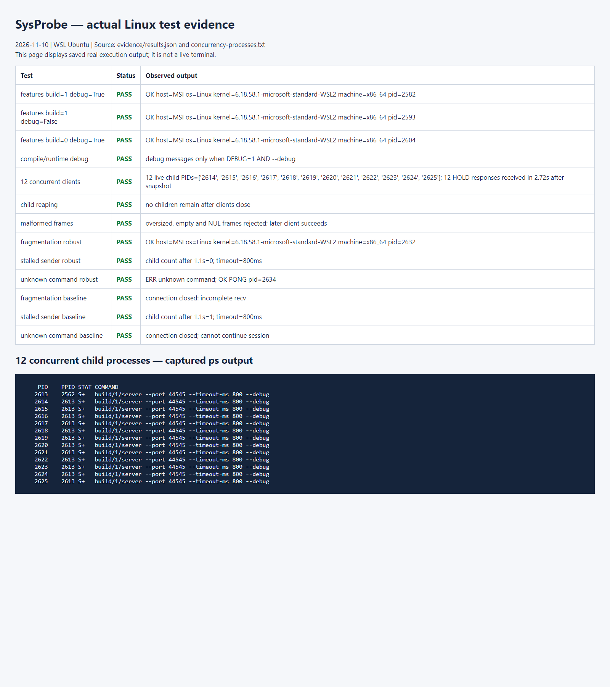

# Midterm Project Report: SysProbe

Name / Student ID: To be completed. Test date: 2026-11-10 (Asia/Taipei).

## 1. System design

SysProbe provides remote system information and health checks. A Linux C client sends commands over IPv4 TCP. The parent server uses a nonblocking listener and poll, then calls fork after accepting each connection. The child closes the listener; the parent closes its copy of the accepted socket. Separate processes handle separate clients. No threads are used.

```text
client -- TCP -- parent server (accept / fork / reap)
                 |-- child A: client A requests
                 |-- child B: client B requests
                 +-- ... up to 64 children
client --+
         +-- dynamically link libsysprobe.so
server --+
```

Commands include SYSINFO (uname hostname, OS, kernel, architecture, child PID), MEMORY (sysinfo uptime, total/free RAM, one-minute load), DISK (statvfs total and available space on `/`), PING, HOLD 1-10, and QUIT. Free RAM is the kernel's free-memory value, not an available-memory estimate including reclaimable caches. Load is not CPU utilization.

The protocol uses a 4-byte unsigned big-endian payload length followed by 1-4096 bytes of non-NUL text. Commands are ASCII. Responses use the same framing and start with `OK ` or `ERR `. Connections support successive requests; the server receives a complete request before replying. HOLD is a bounded concurrency demonstration.

## 2. Key source files

| File | Responsibility |
|---|---|
| `src/server.c` | accept/fork, 64-child limit, command dispatch, system queries, child tracking/reaping, shutdown |
| `src/client.c` | CLI parsing, connection, request transmission, response output, exit status |
| `src/common.c` | Framed I/O, deadlines, poll, partial transfers, DNS/connection, number parsing, PID-tagged logging |
| `include/common.h` | Shared interfaces and debug macro |
| `Makefile` | PIC shared library, executables, ORIGIN rpath, separate debug/release directories |
| `tests/integration.py` | C client tests, 12-client concurrency, fault injection, evidence collection |

The Makefile builds `libsysprobe.so` with `-fPIC -shared`. Both executables dynamically link with `-lsysprobe`; `$ORIGIN` rpath locates the library beside each executable. See `evidence/server-ldd.txt` and `client-ldd.txt`. Logging is implemented in the shared library. `make DEBUG=0` removes DEBUG calls at compile time; `--debug` enables them at runtime when compiled in.

## 3. Robustness mechanisms and comparisons

Each frame uses an absolute CLOCK_MONOTONIC deadline. Partial transfers do not reset it. After poll, MSG_DONTWAIT prevents a blocking transfer; EINTR/EAGAIN are retried. MSG_NOSIGNAL avoids SIGPIPE termination after a peer disconnects. Length is checked before reading the body, and NUL bytes are rejected. The parent uses waitpid(WNOHANG) during its 100ms poll cycle to reap children. SIGINT/SIGTERM handlers only set a stop flag; normal control flow closes the listener, terminates children, and reaps them.

`--baseline` disables selected mechanisms for a controlled teaching comparison without introducing memory corruption.

| Test | Robust mode | Baseline mode |
|---|---|---|
| Send one SYSINFO body byte, then the remainder after 200ms | Complete request received; successful reply | Incomplete single recv closes the connection |
| Send one header byte, then wait 1.1 seconds | Child reaped after the 800ms deadline | Child remains waiting for the header |
| Send INVALID, then PING on the same connection | ERR followed by OK PONG | Unknown command closes the connection |

The same integration script runs each case against both modes; results are in `evidence/results.json`. Other tests verify rejection of empty, oversized, and NUL-containing frames, followed by successful service to a new client. Baseline retains length bounds and parent management; it does not disable every protection.

## 4. Runtime proof

On WSL Ubuntu Linux, `make test` passed 13 checks. Compilation used `-Wall -Wextra -Wpedantic -Werror`. The test opened 12 TCP connections and sent HOLD 3 to each. After 0.3 seconds it read 12 live child PIDs from `/proc/<parent>/task/<parent>/children`, saved their parent-child relationships using ps, and received responses from 12 distinct child PIDs. This proves at least 10 clients were served concurrently rather than merely queued in the listen backlog. After disconnection, the test verified that no children remained.

Actual PIDs, platform, timing, and output are preserved in `evidence/results.json` and `concurrency-processes.txt`. Reruns produce different PIDs. Python sockets provide precise fragmented test traffic; the server under test is implemented in C.

## 5. Execution evidence and packet capture

The following browser screenshot displays saved real test results and a ps snapshot. It is not a live terminal screenshot. The source page is `evidence/execution.html`. The image records the 2026-11-10 run and is not automatically regenerated when tests update the text evidence.



If terminal workflow screenshots are required, capture:

1. Successful make, server startup, and client SYSINFO/MEMORY/DISK output.
2. The 12-client PASS and `cat evidence/concurrency-processes.txt`.
3. All three robust/baseline comparisons.
4. DEBUG=1 with --debug, DEBUG=1 without --debug, and DEBUG=0 with --debug.
5. libsysprobe.so in ldd output for both executables.

Packet capture will be performed by the student. See [PACKET_CAPTURE.md](PACKET_CAPTURE.md). No pcap has been supplied and packet analysis is pending. Add the actual handshake, SYSINFO request, response, connection termination, and corresponding analysis before submission.

## 6. Limitations and extensions

This version targets Linux; tests use sysinfo and `/proc`. Only IPv4 is supported. DNS resolution through getaddrinfo is outside the TCP connection deadline. The server permits 64 children and 4096 bytes per frame; the default I/O deadline is three seconds. HOLD processing time is separate. Logging uses best-effort writes without a persistent queue. Authentication and TLS are not implemented; the default listener is loopback. Cross-computer demonstrations should use a controlled classroom environment. Possible extensions include authentication, TLS, JSON responses, and CPU trends. The current project focuses on processes, networking, shared libraries, and robustness.

## 7. Complete source code

The repository contains complete source in `src/`, `include/`, `Makefile`, and `tests/`. If a single report document is required, append their full contents. Executable binaries alone are not a source-code submission.
